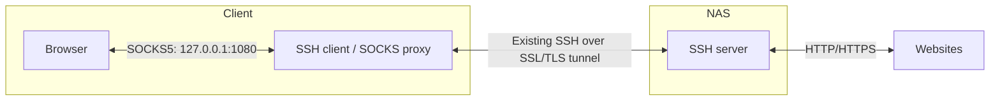

# Web Proxy

## How to browse the web over SSH over SSL/TLS

With the [SSH over SSL/TLS tunnel](ssh.md#how-to-tunnel-ssh-over-ssltls) already working, SSH dynamic forwarding can provide a local SOCKS proxy. Your browser runs on the client (e.g. Windows) and sends website connections through the tunnel; the NAS connects to the websites. No extra stunnel configuration or browser on the NAS is needed. The NAS SSH server must allow TCP forwarding.



### Start the SOCKS Proxy

With stunnel running, open PowerShell and run the following, replacing `your-nas-user` with your NAS username:

```powershell
ssh -N -D 127.0.0.1:1080 -p 5022 your-nas-user@127.0.0.1
```

`-D` creates a SOCKS proxy accessible only on this Windows client at port `1080`; `-N` keeps the connection open without a remote shell. Leave the command running while browsing, and press `Ctrl+C` to stop it.

### Configure the Browser

In a browser that supports SOCKS proxies, configure the following (setting names vary):

- Proxy type: **SOCKS5**
- Proxy host: `127.0.0.1`
- Proxy port: `1080`
- Separate HTTP/HTTPS proxy fields, if present: leave blank
- DNS resolution: use the proxy to resolve website names, if configurable

Visit a public IP-checking website to confirm it shows the NAS network's public IP. Only traffic using the proxy is covered, not the entire device. Restore the browser's previous proxy settings when you stop the tunnel.